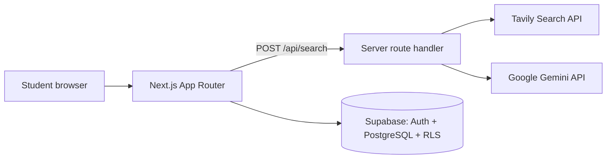

# Scholarship Tracker

**Find, evaluate, and track scholarship applications in one place.**


**Live demo:** https://scholarship-tracker-beta.vercel.app

---

## Table of contents

1. [The problem](#the-problem)
2. [The solution](#the-solution)
3. [Features and status](#features-and-status)
4. [How the search works](#how-the-search-works)
5. [Design principles for trustworthy AI](#design-principles-for-trustworthy-ai)
6. [Architecture](#architecture)
7. [Tech stack](#tech-stack)
8. [Getting started](#getting-started)
9. [Security and privacy](#security-and-privacy)
10. [Current limitations](#current-limitations)
11. [Roadmap](#roadmap)
12. [Vision: prepare before you apply](#vision-prepare-before-you-apply)
13. [About the author](#about-the-author)
14. [License](#license)

---

## The problem

Students who look for scholarships usually juggle search engines, spreadsheets, and note-taking apps. Deadlines are missed, links are lost, and eligibility rules are buried in long web pages. For students in West Africa the problem is often sharper: information is scattered across websites, social media groups, and word of mouth, it is rarely clear whether a scholarship accepts applicants from a given country, and fraudulent offers that charge application fees are a known risk.

A single missed deadline can mean losing an award worth thousands of dollars.

## The solution

Scholarship Tracker centralizes the whole application workflow. A student describes what they are looking for in plain language, receives structured results gathered live from the web, saves the scholarships that matter, and follows each application until the decision.

## Features and status

| Feature | Status |
|---|---|
| Google sign-in (Supabase Auth) | Available |
| Live scholarship search from a plain-language query | Available |
| Structured extraction: name, amount, deadline, country | Available |
| Save scholarships to a private tracker, with duplicate prevention | Available |
| Applications dashboard with status pipeline (To do, In progress, Submitted, Accepted, Rejected) | Available |
| Deadline countdown (J-7, J-3, expired) and editable deadlines | Available |
| Email magic-link sign-in | In progress (production email delivery pending) |
| Eligibility signals: study level, funding coverage, Benin eligibility | In progress |
| Scam warning when a page mentions application fees | In progress |
| Favorites, filters, and scholarship detail view | In progress |
| Document checklist and notes per application | Planned |
| Manual entry of scholarships found offline | Planned |
| Automatic email reminders before deadlines | Planned |
| Student profile and personalized recommendations | Planned |
| Curated catalog and "For you" suggestions | Planned |
| "Get prepared" hub for leadership and volunteering programs | Planned |
| AI-assisted cover letter drafting | Planned |

## How the search works

1. The student submits a query such as "Master's in finance in Canada 2026".
2. The server verifies the session, validates the input, and queries the Tavily search API for current web sources.
3. Google Gemini converts the source excerpts into structured records: name, amount, deadline, country, study level, funding coverage, eligibility signals, and a fee warning flag.
4. The server validates every field before returning it to the client.
5. The student saves a result to their private tracker.

## Design principles for trustworthy AI

Scholarship information is high-stakes, so the extraction pipeline is designed to avoid confident mistakes.

- **Links never come from the model.** Every link is taken from the search source, so the model cannot invent a URL.
- **Dates are accepted only when complete.** A deadline is kept only if the day, month, and year are explicit in the source. Otherwise it is left empty.
- **Uncertainty is explicit.** Eligibility defaults to "unknown". A positive value requires explicit evidence in the source text.
- **Strict validation.** Enumerated fields are checked against whitelists on the server. Unknown values are discarded.
- **The user stays in control.** Extracted data can be edited, and every result carries a reminder to verify conditions on the official website.

## Architecture



The search route runs on the server so that third-party API keys are never exposed to the browser. Personal data lives in Supabase and is protected by Row Level Security.

## Tech stack

| Layer | Technology |
|---|---|
| Frontend | Next.js (App Router), TypeScript, Tailwind CSS, shadcn/ui |
| Authentication and database | Supabase (Auth, PostgreSQL, Row Level Security) |
| Web search | Tavily API |
| AI extraction | Google Gemini API |
| Hosting | Vercel |
| Package manager | pnpm |

## Getting started

### Prerequisites

- Node.js 20 or later
- pnpm
- A Supabase project
- Tavily and Google Gemini API keys (both offer free tiers)

### Installation

```bash
git clone https://github.com/DonaFidele/scholarship-tracker.git
cd scholarship-tracker
pnpm install
cp .env.example .env.local
```

### Environment variables

Fill in `.env.local`:

| Variable | Description |
|---|---|
| `NEXT_PUBLIC_SUPABASE_URL` | Your Supabase project URL |
| `NEXT_PUBLIC_SUPABASE_ANON_KEY` | Supabase publishable (anon) key |
| `TAVILY_API_KEY` | Tavily API key (server only) |
| `GEMINI_API_KEY` | Google Gemini API key (server only) |

Never commit `.env.local`. It is already listed in `.gitignore`.

### Database

Run the SQL in `supabase/schema.sql` from the Supabase SQL Editor. It creates the `applications` table and the Row Level Security policies.

Then configure authentication in the Supabase dashboard:

1. Enable the Google provider under Authentication, Providers.
2. Add `http://localhost:3000/auth/callback` to the Redirect URLs.

### Run

```bash
pnpm dev
```

Open http://localhost:3000.

### Project structure

```text
app/
  login/               Sign-in page
  search/              Search page
  applications/        Personal tracker
  auth/callback/       OAuth and magic-link session exchange
  api/search/          Server route: Tavily search + Gemini extraction
components/            UI components (search, applications, shared)
lib/
  supabase/            Browser, server, and middleware clients
  types.ts             Shared TypeScript types
middleware.ts          Route protection and session refresh
```

## Security and privacy

- **Row Level Security:** each user can only read and modify their own rows.
- **Server-side session checks:** the search API rejects unauthenticated requests.
- **Secrets stay on the server:** Tavily and Gemini keys are never sent to the browser.
- **Minimal data:** the app stores the account email and the applications the user chooses to save.

## Current limitations

- Extracted information is generated automatically and can be incomplete or wrong. Users must confirm deadlines and conditions on the official website.
- The project runs on free tiers of third-party services, so search volume is limited.
- While the Google OAuth consent screen is in testing mode, only approved test accounts can sign in with Google.

## Roadmap

| Version | Theme | Highlights |
|---|---|---|
| MVP | Find and track | Live search, private tracker, deadline countdown |
| V1.1 | Manage the file | Document checklist, notes, manual entry, email reminders |
| V1.2 | Judge quickly | Level, coverage, eligibility signals, scam warning, favorites, on-demand details from the official page, criteria a scholarship values (leadership, volunteering) |
| V1.3 | Personalization | Student profile, ranked recommendations with explanations, account deletion |
| V1.4 | Proactive discovery | Curated catalog, "For you" suggestions, "Get prepared" hub |
| V1.5 | Orientation | Suggested study pathways, weekly email digest |
| V2 | Take action | AI-assisted cover letter based on the profile and the scholarship criteria |

## Vision: prepare before you apply

Most selection committees value leadership, community service, and a clear study or career project. These qualities take months to build, yet students usually discover the criteria only when they start applying, when it is too late to act.

Scholarship Tracker aims to move that moment earlier. Beyond finding scholarships, the platform will surface concrete programs in leadership, volunteering, and mentorship that students often do not know exist, and connect them to what each scholarship values. The goal is to help students build a competitive profile before the deadline, not during the last two weeks.

## About the author

Built by **Dona Fidèle Houekpoeha**, [program] student at [university].

- GitHub: [DonaFidele](https://github.com/DonaFidele)
- Contact: [your email]

## Acknowledgments

Thanks to the teams behind Next.js, Supabase, Vercel, shadcn/ui, Tavily, and Google Gemini, whose tools make projects like this reachable for student builders.

## License

Copyright (c) 2026 Dona Fidèle Houekpoeha. All rights reserved. See [LICENSE](LICENSE) for details, including the evaluation permission granted to review committees.
